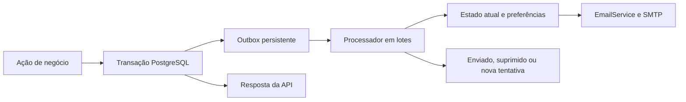

# Notificações de e-mail

## Escopo da análise

Foram revisados os casos de uso e as rotas de autenticação, perfil, organizações, eventos, checkout, parcelas, ingressos
nominais, reembolsos, financeiro, repasses, análise de recebimento, equipes/IAM, CMS e formulários. A decisão é enviar
avisos quando houver uma mudança útil de estado ou uma ação que a pessoa precise tomar. Consultas, salvamento de
rascunho, edição visual e atualizações internas do provedor não devem produzir e-mails.

Existiam mais mensagens além da compra, mas os envios estavam distribuídos entre Supabase Auth, `EmailService` e
`DeliverTickets`. As novas notificações têm catálogo, preferências persistidas e processamento independente da
requisição original.

## Envios existentes preservados

| Ação / origem                                                                    | Destinatário                       | Mensagem                                                                         |
| -------------------------------------------------------------------------------- | ---------------------------------- | -------------------------------------------------------------------------------- |
| `POST /api/auth/register`, `/register/resend`, `AuthService`                     | Pessoa que está se cadastrando     | Confirmação do endereço pelo Supabase Auth                                       |
| `POST /api/auth/password/request`, `/forgot-password`                            | Titular da conta                   | Recuperação de senha pelo Supabase Auth                                          |
| `POST /api/user/email/request`                                                   | Endereço informado pelo titular    | Confirmação do e-mail faltante, pelo Supabase Auth                               |
| `PATCH /api/user/password`                                                       | Titular                            | Alerta de senha alterada, por `sendPasswordChangedNotice`                        |
| `PATCH /api/user/profile`, alteração de CPF                                      | Titular                            | Alerta de CPF alterado, por `sendDocumentChangedNotice`, sem incluir o documento |
| Checkout gratuito ou confirmado, webhook/reconciliação, `DeliverTickets.execute` | Comprador                          | Confirmação com PDF dos ingressos liberados, agrupados por compra                |
| Entrega e `PATCH /api/user/tickets/:id/attendee`                                 | Participante nomeado               | “Seu ingresso chegou”, com PDF do próprio ingresso                               |
| Convite ou reenvio em `/api/organizer/iam/invitations` e IAM da plataforma       | Endereço convidado                 | Convite para equipe com link de aceite                                           |
| Reenvio autorizado nas rotas de e-mail                                           | Comprador/participante do ingresso | Reenvio do ingresso existente                                                    |

Estes fluxos continuam usando os serviços existentes. **Esta entrega não migra os PDFs, códigos de autenticação ou
convites para a nova fila.** O método legado `sendRegistrationConfirmation` existe, mas a entrega nominal atual é feita
por `DeliverTickets`. O campo legado `registration_confirmation_email` não representa um controle efetivo dos avisos
novos.

## Novos disparos implementados

Todos os itens abaixo possuem template HTML e texto, identificação Flouvi e link para a área apropriada. São ativados
pelo processamento da fila.

| Evento no catálogo             | Ação que gera o aviso                                                                            | Destinatário                               | Preferência               |
| ------------------------------ | ------------------------------------------------------------------------------------------------ | ------------------------------------------ | ------------------------- |
| `welcome`                      | Primeira confirmação do e-mail em `auth.users`, inclusive cadastro com endereço já confirmado    | Titular                                    | Boas-vindas               |
| `purchase_pending`             | Criação de compra pendente no checkout; espera 2 minutos e confere se ainda há pagamento a fazer | Comprador                                  | Atualizações de pagamento |
| `installment_paid`             | Confirmação de parcela Pix enquanto ainda há parcelas em aberto                                  | Comprador                                  | Atualizações de pagamento |
| `payment_reminder`             | Parcela a vencer nas próximas 24 h; outro aviso entre 24 e 48 h após o vencimento                | Comprador                                  | Lembretes de parcelas     |
| `purchase_refunded`            | Compra passa para `refunded`, após confirmação do provedor ou liquidação simulada                | Comprador                                  | Essencial                 |
| `event_changed`                | Evento publicado muda data, horário, endereço, local ou link de acesso online                    | Compradores com pedido ativo               | Mudanças no evento        |
| `event_cancelled`              | Organização cancela o evento                                                                     | Compradores com pedido ativo               | Essencial                 |
| `event_reminder`               | Evento publicado começa nas próximas 24 h                                                        | Compradores com pedido pago/gratuito ativo | Lembrete do evento        |
| `organization_created`         | `OrganizerService` ou fluxo legado cria organização                                              | Proprietário                               | Cadastro e situação       |
| `organization_status`          | Situação da organização muda                                                                     | Proprietário                               | Cadastro e situação       |
| `organization_sale`            | Compra inteira confirmada; registros do mesmo checkout são agrupados                             | Proprietário                               | Novas vendas confirmadas  |
| `organization_refund`          | Confirmação de reembolso de compra do evento                                                     | Proprietário                               | Reembolsos                |
| `organization_payout`          | Solicitação de repasse ou mudança para concluído, falhou ou cancelado                            | Proprietário                               | Repasses                  |
| `organization_receiving`       | Análise de recebimento aprovada ou rejeitada                                                     | Proprietário                               | Conta de recebimento      |
| `organization_event_published` | Evento passa para publicado                                                                      | Proprietário                               | Publicação de eventos     |

A confirmação final e os PDFs continuam saindo **somente depois da liberação dos ingressos**. Pix parcelado não é
anunciado como venda quitada antes de pagar tudo. O aviso de parcela considera a quantidade efetivamente paga, mesmo que
as parcelas tenham sido pagas fora de ordem. O reembolso não apresenta o total do pedido como se fosse o valor devolvido
de uma cobrança Pix individual.

Avisos da organização usam o e-mail confirmado da conta do proprietário, nunca um endereço arbitrário do formulário de
contato. Equipe inteira, participantes sem conta e contatos externos não entram automaticamente nessa lista. Os
participantes nomeados continuam recebendo os ingressos pelo fluxo de entrega existente.

## Preferências

A opção de novas vendas avisa sobre compras pagas. A inscrição totalmente gratuita continua entregando o ingresso ao
comprador pelo fluxo existente, sem aviso de venda ao proprietário.

- Conta: `/perfil?section=preferences`, seção **Notificações por e-mail**.
- Organização: `/admin/configuracoes`, seção **Notificações por e-mail**.
- API: `GET/PUT /api/user/notification-preferences` e `GET/PUT /api/organizer/notification-preferences`.
- A API deriva a pessoa e a organização da sessão; não aceita IDs de terceiros nem destinatários no corpo. A organização
  exige `organization.read` para consultar e `organization.update` para alterar. Sem permissão de alteração, os
  controles aparecem somente para consulta.
- As opções operacionais começam habilitadas. O `PUT` substitui o conjunto; a interface envia todas as opções. Campos
  desconhecidos e valores que não sejam booleanos são rejeitados.
- Um aviso da organização exige **a opção da organização e a opção pessoal “Avisos das minhas organizações”**.
  Desabilitar qualquer uma impede o envio.
- Reembolso e cancelamento do evento não têm opção de desativação. Confirmações, ingressos e segurança também continuam
  essenciais nos fluxos existentes.
- Preferências são consultadas no momento do envio, inclusive em novas tentativas. A fila resolve o e-mail atual e exige
  conta ativa, endereço confirmado e ausência de bloqueio. Marcar um aviso como suprimido não apaga a preferência.

## Arquitetura e desempenho



Os triggers escrevem apenas no banco. Não há SMTP, HTTP ou montagem de PDF dentro da transação. A alteração de negócio e
o registro na fila são atômicos; um rollback também desfaz o aviso. Essa abordagem abrange alterações feitas pela API e
pelos RPCs de webhook/reconciliação sem duplicar chamadas de e-mail em cada rota.

O domínio fica em `application/notifications`; as portas separam fila, destinatário e envio. Adaptadores Supabase e
composição SMTP ficam em `infrastructure`. Os schemas e o catálogo público ficam em
`packages/contracts/src/notifications.ts`. O frontend utiliza a API, sem acesso direto ao banco.

Detalhes operacionais:

- Até 10 mensagens por lote, processamento sequencial. Lotes cheios iniciam o próximo ciclo em 1 segundo para esvaziar a
  fila; lotes menores aguardam 30 segundos para reduzir consultas ociosas. Réplicas coordenam o trabalho com
  `FOR UPDATE SKIP LOCKED`.
- Concessão de processamento de 15 minutos, token por tentativa e confirmação condicionada à concessão atual. Uma
  máquina interrompida não perde a fila.
- Até 8 tentativas. Intervalo exponencial de 1, 2, 4, 8… minutos entre falhas. Atingido o limite, a mensagem fica em
  `failed` para investigação.
- Chave única por evento e destinatário. `EmailService` também reutiliza uma chave de entrega por mensagem. Um aviso em
  envio por outro processo não é tratado como entregue.
- SMTP continua tendo semântica de **pelo menos uma vez**: se o servidor aceitar a mensagem e o processo morrer antes de
  registrar o resultado, pode haver repetição. Não existe promessa de entrega exatamente uma vez com SMTP.
- Alterações de evento registram uma tarefa de distribuição. O agendador processa até 5 tarefas e 200 compradores por
  tarefa a cada ciclo, com cursor persistente; não percorre milhares de compradores na requisição de edição do evento.
- Lembretes são gerados em lotes limitados, com índices e chave de deduplicação. Antes de enviar, pagamentos,
  cancelamentos e reagendamentos são conferidos.
- O e-mail de alteração de evento apresenta os dados atuais. Mudança de data invalida o lembrete anterior. Pedido
  reembolsado não recebe lembrete de ingresso.
- Registros concluídos da outbox e distribuições concluídas são removidos após 90 dias, em lotes. Isso não altera a
  retenção do histórico `email_deliveries` preexistente.
- Outbox e funções de processamento são restritas ao backend. Payloads não incluem CPF, dados bancários, tokens de
  autenticação, QR Pix nem respostas SMTP brutas. Os logs do processador contêm somente contagens ou mensagens
  genéricas.

## Ativação por ambiente

1. Aplicar as migrations `202611190006_email_notifications.sql`, `202611190007_event_notification_location_fields.sql` e
   `202611190008_notification_purchase_lookup.sql` antes de publicar o código que lê as preferências. A estrutura é
   aditiva, sem seed nem reenvio histórico de boas-vindas para contas já confirmadas.
2. Configurar o SMTP da API (`SMTP_*`, `EMAIL_FROM`). Em desenvolvimento local, usar o Mailpit; na nuvem ele não está
   disponível. O SMTP do Supabase Auth é uma configuração separada, necessária para códigos de autenticação.
3. Definir `EMAIL_NOTIFICATIONS_ENABLED=true` na API. O padrão é `false` para permitir publicar a migration e revisar a
   configuração antes do primeiro envio. Os triggers já registram ações enquanto o processador estiver desativado; ao
   ativar, as pendências são reavaliadas.
4. Gerar `NOTIFICATIONS_WORKER_TOKEN` exclusivo, com pelo menos 32 caracteres. Armazenar como secret da API e do
   environment `development` do GitHub. Não usar chave de banco, token Fly ou credencial SMTP como token do agendador.
5. No GitHub, configurar a variable `NOTIFICATIONS_API_URL` com a URL HTTPS da API no environment `development` e a
   variable **do repositório** `EMAIL_NOTIFICATIONS_ENABLED=true` (usada antes de iniciar o job). O workflow
   `email-notifications.yml` chama `POST /internal/notifications/process` a cada 10 minutos. O corpo é vazio; não
   permite escolher destinatários ou mensagens. Há também `workflow_dispatch`.

O processamento local ocorre enquanto a API está rodando. O agendador externo acorda a API no Fly quando ela está
suspensa; o timer em memória sozinho não atende esse cenário. O workflow incluído atende o ambiente `development`
existente; produção deve ter sua própria URL, environment e token.

O agendamento do GitHub pode sofrer atrasos e não garante execução em um segundo exato. Lembretes usam janelas de tempo
e revalidação, não horário exato. Para volume alto ou requisitos de pontualidade, executar o processador continuamente
em um worker dedicado e monitorar a idade da fila. Referência:
[eventos agendados do GitHub Actions](https://docs.github.com/en/actions/reference/workflows-and-actions/events-that-trigger-workflows#schedule).
Os limites de espera SMTP foram definidos explicitamente; ver [timeouts do Nodemailer](https://nodemailer.com/smtp).

Monitoramento sem ler conteúdo pessoal:

```sql
select status, count(*) as quantity, min(created_at) as oldest
from public.notification_outbox
group by status;
```

Não reenfileirar `sent` ou `suppressed` automaticamente. Para reprocessar uma falha terminal, investigar o
provedor/configuração e reativar apenas os IDs afetados; preferências e elegibilidade serão consultadas novamente. A
ativação do agendador não faz parte do deploy automático do código.

## Decisões de não envio

| Fluxo avaliado                                                                           | Decisão                                                                                                                                                       |
| ---------------------------------------------------------------------------------------- | ------------------------------------------------------------------------------------------------------------------------------------------------------------- |
| Login, refresh, consulta de eventos/ingressos, download de PDF, dashboards e exportações | Não enviar; são ações frequentes sem necessidade de aviso                                                                                                     |
| Erros transitórios de checkout, cotação, geração de QR e tentativas internas do gateway  | Não enviar para evitar alarmes durante retentativas; pagamento pendente já oferece acompanhamento                                                             |
| Alteração de preço, cupom, lote, imagem, descrição, vídeo e layout Puck                  | Não enviar a compradores; não altera o que já foi contratado                                                                                                  |
| Rascunhos e salvamentos do CMS                                                           | Não enviar; publicação de evento tem confirmação própria                                                                                                      |
| Mudanças de participante                                                                 | Preservar entrega do novo ingresso pelo serviço existente; aviso de revogação ao participante anterior exige regra específica                                 |
| Formulários públicos do CMS                                                              | `SubmitForm` grava respostas. Envio de protocolo/resposta deve ter destinatário validado e template específico; não usar `forms.emails` como envio irrestrito |
| Check-in                                                                                 | Sem e-mail por leitura de QR; reduz ruído e não atrasa a entrada                                                                                              |
| Novos dispositivos, disputas/chargebacks e alertas de fraude                             | Próxima etapa, com evento confiável e política específica; não inferir de qualquer login ou status temporário                                                 |
| Relatório diário de vendas, baixo estoque e evento encerrado                             | Próxima etapa, com agregação, período e frequência explícitos                                                                                                 |
| Recomendações, newsletter, recuperação de carrinho abandonado e promoções                | Fora deste catálogo operacional; exigem consentimento e descadastro próprios, desativados por padrão                                                          |
| Avisos a toda a equipe ou participantes externos                                         | Próxima etapa com destinatários autorizados, permissões e preferências individuais                                                                            |

## Verificação

Testes de contratos validam preferências e catálogo. Na API, `notification-*.test.ts` cobrem opt-outs, mensagens
essenciais, rotas, autorização, processamento, falhas, deduplicação, templates, agendador e credencial. No frontend,
`EmailNotificationPreferences.test.tsx` cobre carregamento, gravação, falha, retentativa, permissão e troca de
organização. `supabase/tests/email_notifications.sql` valida os triggers, lembretes, quitação, dados atuais, isolamento
e concessões em PostgreSQL. Testes SQL rodam somente em banco descartável, como o gate do pipeline.

Validação desta implementação em 19/11/2026:

- `pnpm --filter @events-manager/api test`: 1.288 testes passaram.
- `pnpm --filter @events-manager/contracts test:coverage`: 382 testes e limiares passaram.
- `pnpm --filter @events-manager/web test:coverage --maxWorkers=2`: 1.151 testes passaram; a execução retorna erro
  exclusivamente pelos limiares globais de cobertura ainda não atingidos.
- `pnpm lint` e `pnpm --filter @events-manager/web exec tsc --noEmit`: passaram.
- `supabase test db --local` no banco descartável: 32 testes SQL passaram.
- Navegador: gravação e persistência após reload nas duas áreas; larguras de 1.440 e 390 px, sem overflow horizontal.
- Integração local real: fila enviou boas-vindas e cadastro da organização ao Mailpit, uma tentativa por mensagem. Os
  dois e-mails, a conta e a organização temporários foram removidos após a verificação.

A cobertura global aumentou, mas permanece abaixo de limites preexistentes: branches da API 78,10% (mínimo 83,5%);
branches do frontend 71,86% (mínimo 79,1%) e funções do frontend 77,06% (mínimo 78,5%). Os limites não foram reduzidos.
Os testes alterados/adicionados estão nos arquivos `notification-*.test.ts`, `env.test.ts`,
`nodemailer-attachments.test.ts`, `notifications.test.ts`, `EmailNotificationPreferences.test.tsx` e
`email_notifications.sql`.

Evidências visuais: [preferências da conta](evidencias/notificacoes-email/conta-desktop.png) e
[preferências da organização](evidencias/notificacoes-email/organizacao-desktop.png).
